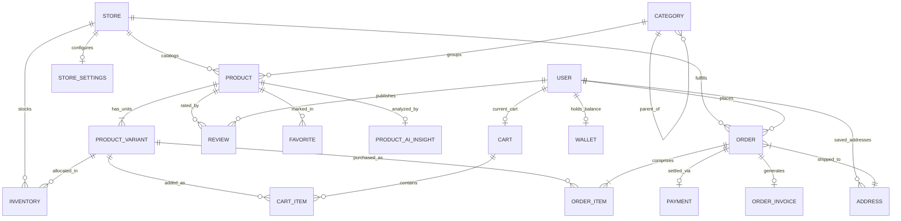
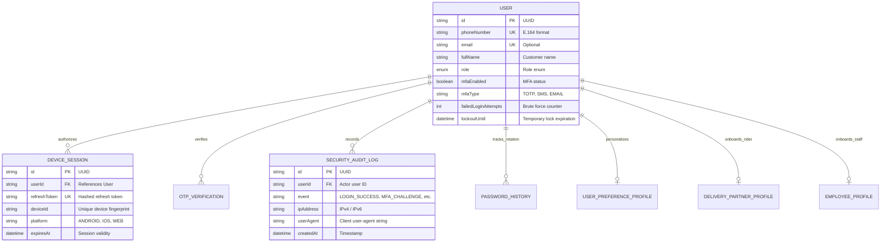
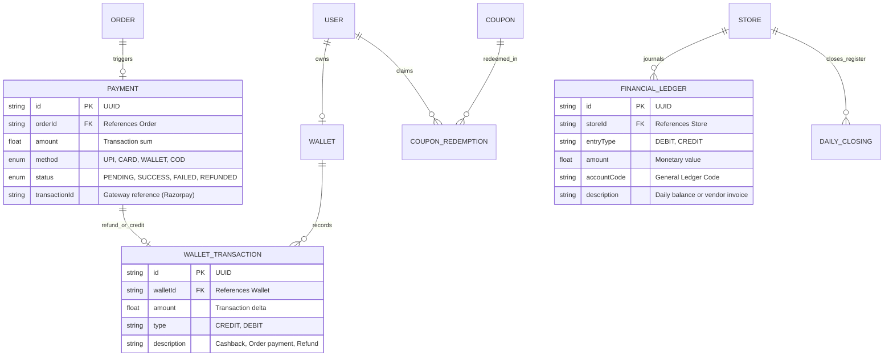
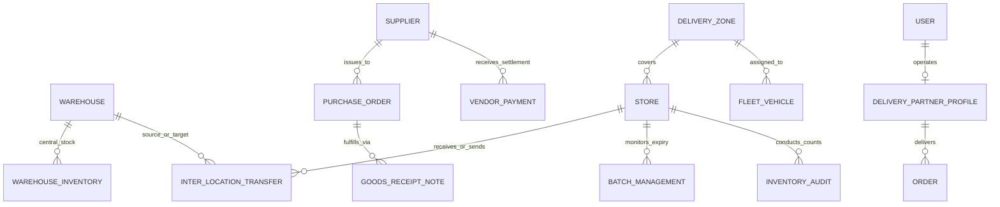
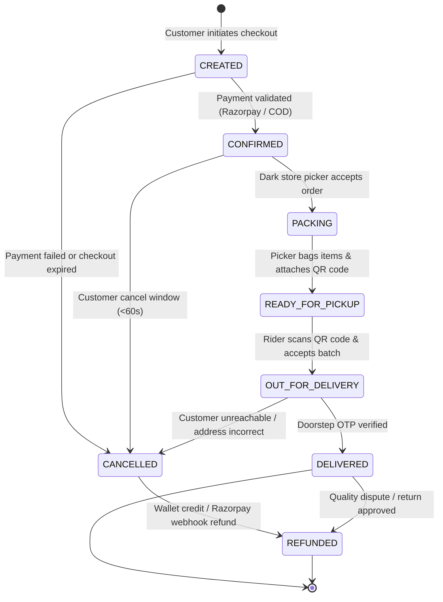
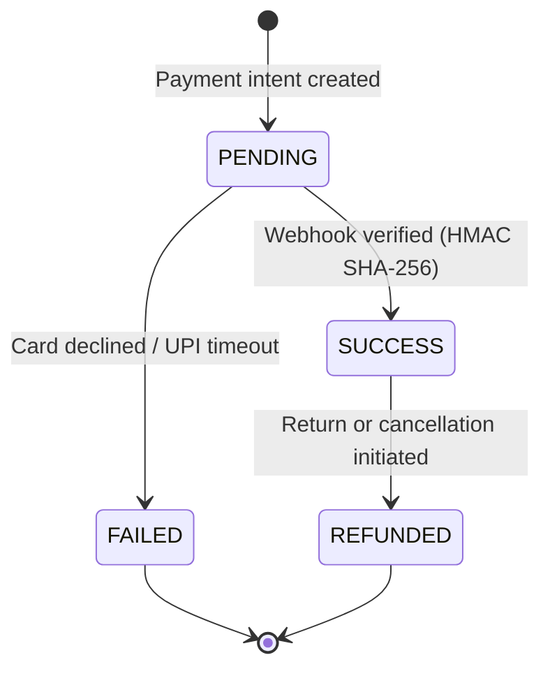

# 📊 Daily Basket — Enterprise Data Model & Entity Architecture

> **Authoritative Specification**: Defines all data entities, relationships, domain boundaries, state lifecycles, and relational topologies for the **Daily Basket** hyperlocal quick-commerce platform.
>
> **Related Documentation**:
> - 🧱 [Database Schema & Data Dictionary](file:///c:/Users/kalin/.gemini/antigravity-ide/scratch/daily-basket/SCHEMA.md)
> - 🔄 [Database Migrations & Change Management](file:///c:/Users/kalin/.gemini/antigravity-ide/scratch/daily-basket/MIGRATIONS.md)
> - 🔐 [Row-Level Security & Access Policies](file:///c:/Users/kalin/.gemini/antigravity-ide/scratch/daily-basket/RLS-POLICIES.md)
> - 🗄️ [Prisma Schema Definition](file:///c:/Users/kalin/.gemini/antigravity-ide/scratch/daily-basket/services/api/prisma/schema.prisma)

---

## 1. Architectural Overview & Design Philosophy

Daily Basket is built on a **Domain-Driven Design (DDD)** relational data model backed by **PostgreSQL 16** and managed via **Prisma ORM 5**. The architecture is optimized for:

- **Sub-250ms Query Latency**: Strict relational indexing, query projection, and composite keys ensure lightning-fast read operations for customer catalog browsing and dark store dispatch.
- **Hyperlocal Multi-Store Partitioning**: Every dark store (`Store`) acts as an operational nexus with isolated physical inventories, pricing overrides, and fulfillment radii.
- **Concurrency & Atomic State Preservation**: Two-phase stock reservation (`stockQuantity` vs `reservedQuantity`) eliminates race conditions during flash-sales and peak checkout bursts.
- **Multimodal AI Integration**: Dedicated sub-schemas capture conversational AI shopping sessions, multimodal visual searches, voice logs, and customer affinity models without polluting transactional tables.
- **End-to-End Enterprise Operations**: Complete data pipelines connecting dark store picking, warehouse transfers, fleet dispatch, supplier purchase orders, and daily financial ledgers.

```
+---------------------------------------------------------------------------------------+
|                                DAILY BASKET PLATFORM                                  |
+---------------------------------------------------------------------------------------+
|  +--------------------+  +----------------------+  +-------------------------------+  |
|  |   Catalog & Store  |  |    User & Identity   |  |   Cart, Orders & Payments     |  |
|  |   7 Tables         |  |    7 Tables          |  |   10 Tables                       |  |
|  +--------------------+  +----------------------+  +-------------------------------+  |
|  +--------------------+  +----------------------+  +-------------------------------+  |
|  |  Customer & Social |  |   Multimodal AI &    |  |  Voice Shopping Engine        |  |
|  |  9 Tables          |  |   Personalization    |  |  4 Tables                     |  |
|  |                    |  |   16 Tables          |  |                               |  |
|  +--------------------+  +----------------------+  +-------------------------------+  |
|  +--------------------+  +----------------------+  +-------------------------------+  |
|  |  Supply Chain & PO |  |  Financial Ledger &  |  |  Logistics, Fleet & Warehouse |  |
|  |  6 Tables          |  |  Reconciliation      |  |  7 Tables                     |  |
|  |                    |  |  2 Tables            |  |                               |  |
|  +--------------------+  +----------------------+  +-------------------------------+  |
|  +--------------------+  +---------------------------------------------------------+  |
|  | Customer Support   |  |  Enterprise Governance, Observability & Backups         |  |
|  | 3 Tables           |  |  8 Tables                                               |  |
|  +--------------------+  +---------------------------------------------------------+  |
+---------------------------------------------------------------------------------------+
Total: 79 Relational Models | 4 Native Enums | 729 Columns | 114 Foreign Key Relations
```

---

## 2. Bounded Contexts & Entity Domain Breakdown

The Daily Basket relational schema is segmented into **12 Bounded Contexts**:

| # | Bounded Context | Core Entities | Primary Responsibility |
| :- | :--- | :--- | :--- |
| **1** | **Catalog & Store Topology** | `Store`, `Category`, `Product`, `ProductVariant`, `Inventory`, `StoreSettings`, `Banner` | Dark store metadata, hierarchical taxonomy, SKU variants, stock units, and storefront banners. |
| **2** | **Identity, Auth & Security** | `User`, `Address`, `DeviceSession`, `OtpVerification`, `SecurityAuditLog`, `PasswordHistory`, `EmployeeProfile` | Authentication, multi-factor auth (TOTP/SMS), device tokens, delivery addresses, and security audits. |
| **3** | **Cart, Orders & Invoicing** | `Cart`, `CartItem`, `Order`, `OrderItem`, `OrderInvoice` | Persistent customer baskets, atomic order creation, fulfillment queues, and GST-compliant tax invoices. |
| **4** | **Payments, Wallet & Promos** | `Payment`, `Wallet`, `WalletTransaction`, `Coupon`, `CouponRedemption` | Razorpay transactions, cashback balances, ledger credits/debits, discount vouchers, and usage tracking. |
| **5** | **Customer Engagement & CRM** | `Review`, `Favorite`, `Wishlist`, `RecentlyViewed`, `GroceryList`, `UserImpact`, `UserBadge`, `InAppNotification`, `CustomerManagementNote` | Product ratings, saved lists, recurring baskets, carbon offset impact metrics, gamification badges, and CRM notes. |
| **6** | **Customer Support & Care** | `SupportTicket`, `ChatMessage`, `StockAlert` | Live customer service ticketing, omnichannel messaging, and restock notification alerts. |
| **7** | **AI Intelligence & Discovery** | `AiConversationSession`, `AiChatMessage`, `AiAuditLog`, `AiAnalyticsMetric`, `PromptTemplate`, `SearchAnalytics`, `TrendingSearch`, `BlockedQuery`, `ProductAiInsight`, `UserPreferenceProfile`, `ImageSearchLog`, `ProductReferenceImage`, `VisualAiAnalyticsMetric`, `PredictiveReorderItem`, `PersonalizedOffer`, `PersonalizationRule`, `AiCopilotQueryLog` | Conversational shopping agent, visual image match vectors, predictive cart repopulation, and search ranking telemetry. |
| **8** | **Voice Shopping Engine** | `VoiceSession`, `VoiceCommandLog`, `VoiceSettings`, `VoiceAnalyticsMetric` | Multilingual speech-to-intent sessions (English, Hindi, Kannada, Tamil, Telugu), acoustic confidence logs, and speech metrics. |
| **9** | **Inventory Procurement & PO** | `BatchManagement`, `InventoryAudit`, `Supplier`, `PurchaseOrder`, `GoodsReceiptNote`, `VendorPayment` | Lot/batch expiry tracking, dark store stock counting, vendor master data, PO dispatch, and goods receipt verification. |
| **10** | **Financial Accounting** | `FinancialLedger`, `DailyClosing` | Double-entry journal entries, store-level end-of-day register balancing, and cash/digital settlement audits. |
| **11** | **Logistics, Fleet & Hubs** | `DeliveryPartnerProfile`, `DeliveryZone`, `FleetVehicle`, `Warehouse`, `WarehouseInventory`, `InterLocationTransfer`, `Franchise` | Delivery partner onboarding, geospatial delivery polygons, EV fleet telematics, central warehouse buffers, and inter-store stock transfers. |
| **12** | **Enterprise Governance** | `BusinessDocument`, `BusinessInsightLog`, `SystemObservabilityMetric`, `MasterDataConfig`, `WorkflowRule`, `IntegrationConnection`, `DisasterRecoveryBackup` | Compliance contracts, automated business rules, API connectors, telemetry traces, and point-in-time disaster backups. |

---

## 3. Visual Entity-Relationship Diagrams (Mermaid)

### 3.1. Core Customer, Catalog & Order Fulfillment Flow



### 3.2. User Authentication, Device Sessions & Security Subsystem



### 3.3. Payments, Digital Wallet & Financial Reconciliation



### 3.4. Dark Store Supply Chain, Warehousing & Fleet Dispatch



---

## 4. Entity Cardinality & Relational Foreign Key Rules

| Parent Entity | Child Entity | Cardinality | Foreign Key (`Child.FK`) | Referential Action (`onDelete`) | Business Reason |
| :--- | :--- | :---: | :--- | :---: | :--- |
| `Store` | `Product` | `1 : N` | `Product.storeId` | `Cascade` | Catalog items belong to their local dark store. |
| `Store` | `Inventory` | `1 : N` | `Inventory.storeId` | `Cascade` | Physical stock levels belong to the specific store. |
| `Store` | `Order` | `1 : N` | `Order.storeId` | `Restrict` | Historical orders must never be deleted if a store is archived. |
| `Category` | `Category` | `1 : N` | `Category.parentId` | `SetNull` | Root categories have `parentId = null`; subcategories link upwards. |
| `Category` | `Product` | `1 : N` | `Product.categoryId` | `Restrict` | Products must not be orphaned when reorganizing categories. |
| `Product` | `ProductVariant` | `1 : N` | `ProductVariant.productId`| `Cascade` | SKUs, weights, and pack sizes belong strictly to their parent product. |
| `ProductVariant` | `Inventory` | `1 : N` | `Inventory.variantId` | `Cascade` | Variant stock tracking across dark store nodes. |
| `User` | `Address` | `1 : N` | `Address.userId` | `Cascade` | User-saved addresses are purged if the customer account is deleted. |
| `User` | `Order` | `1 : N` | `Order.userId` | `Restrict` | Financial compliance mandates keeping order history for auditing. |
| `User` | `Cart` | `1 : 1` | `Cart.userId` | `Cascade` | Each customer has exactly one active shopping basket. |
| `Cart` | `CartItem` | `1 : N` | `CartItem.cartId` | `Cascade` | Clearing a cart atomically purges its associated line items. |
| `Order` | `OrderItem` | `1 : N` | `OrderItem.orderId` | `Cascade` | Order items form an immutable snapshot of items ordered. |
| `Order` | `Payment` | `1 : N` | `Payment.orderId` | `Cascade` | Payment transactions belong to their respective order. |
| `Order` | `OrderInvoice` | `1 : 1` | `OrderInvoice.orderId` | `Cascade` | Legal tax invoice generated upon order confirmation. |
| `User` | `Wallet` | `1 : 1` | `Wallet.userId` | `Cascade` | Digital customer wallet for cashbacks and credits. |
| `Wallet` | `WalletTransaction` | `1 : N` | `WalletTransaction.walletId` | `Cascade` | Append-only financial ledger of wallet balance adjustments. |
| `User` | `DeviceSession` | `1 : N` | `DeviceSession.userId` | `Cascade` | Multiple active mobile/web sessions for single user. |
| `User` | `SecurityAuditLog` | `1 : N` | `SecurityAuditLog.userId` | `Cascade` | Security incident timeline for authentication actions. |
| `User` | `AiConversationSession` | `1 : N` | `AiConversationSession.userId` | `Cascade` | AI chat sessions initiated by the user. |
| `AiConversationSession` | `AiChatMessage` | `1 : N` | `AiChatMessage.sessionId` | `Cascade` | Conversational messages between shopper and AI agent. |
| `Warehouse` | `WarehouseInventory` | `1 : N` | `WarehouseInventory.warehouseId`| `Cascade` | Bulk buffer stock maintained at distribution hubs. |
| `Supplier` | `PurchaseOrder` | `1 : N` | `PurchaseOrder.supplierId` | `Restrict` | Vendor procurement history must remain immutable. |

---

## 5. State Lifecycles & Transition Machines

### 5.1. Order Fulfillment State Machine (`OrderStatus`)

The order lifecycle adheres to a deterministic state machine managed by dark store picking systems and delivery rider telemetry:



### 5.2. Payment State Machine (`PaymentStatus`)



### 5.3. Inventory Reservation Dynamics

To prevent overselling, stock allocation uses atomic two-phase updates:

$$\text{Available Stock} = \text{stockQuantity} - \text{reservedQuantity}$$

1. **Cart Checkout**: When an order enters `CREATED`, `reservedQuantity` increments by the required units.
2. **Payment Confirmation**: Upon transition to `CONFIRMED`, `stockQuantity` and `reservedQuantity` decrement simultaneously:
   $$\Delta \text{stockQuantity} = -N, \quad \Delta \text{reservedQuantity} = -N$$
3. **Cart Abandonment / Payment Failure**: If payment fails or times out (10 minutes), `reservedQuantity` is released:
   $$\Delta \text{reservedQuantity} = -N$$

---

## 6. Data Integrity & Normalization Standards

1. **Third Normal Form (3NF) Baseline**: All core business transactional entities adhere strictly to 3NF. Redundancies are prohibited except where denormalization is purposefully applied for sub-second read performance (e.g., `OrderItem.unitPrice` and `OrderItem.productName` capturing the point-in-time catalog state).
2. **Immutable Point-in-Time Snapshots**:
   - `OrderItem`: Stores frozen `price`, `productName`, and `unitName` at the moment of order placement to guarantee historical invoicing accuracy even if product details change later.
   - `OrderInvoice`: Persists generated tax breakdowns, CGST/SGST/IGST rates, and store registration numbers.
3. **Geospatial Precision**:
   - Geolocation coordinates (`latitude`, `longitude`) are stored as 64-bit IEEE 754 Floating Points (`DOUBLE PRECISION`), providing sub-meter physical accuracy for dark store dispatch polygons and rider telemetry.
4. **Soft Deletions vs Explicit Deletions**:
   - Products and Variants utilize availability flags (`isAvailable = false`) rather than hard physical deletions to preserve historical order integrity.
   - Session tokens, cart items, and OTPs are hard-deleted upon expiration or invalidation to keep table sizes compact.
