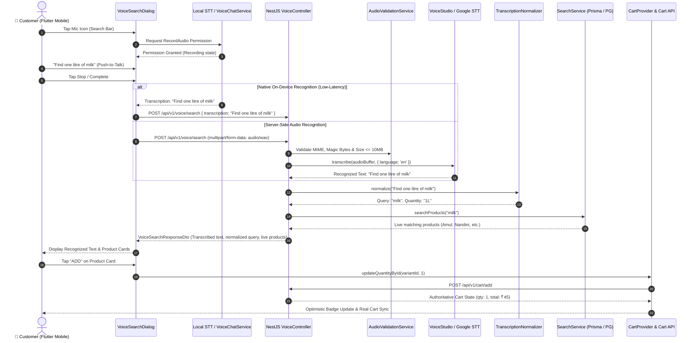

# 🎙️ Real-Time AI Voice Shopping Architecture — Daily Basket

## 1. Overview & System Design

The Real-Time AI Voice Shopping feature enables Daily Basket customers to search and buy grocery items using natural speech (in English, Kannada, or mixed colloquial grocery queries).

The architecture adheres to strict non-negotiable principles:
- **Zero fake results or mock responses**: Audio is captured from real microphone inputs, transcribed by verified Speech Providers (`VoiceStudio` or `GoogleCloudSpeech`), normalized into real search terms and quantity constraints, and executed against the live product catalogue (`Prisma` / `PostgreSQL`).
- **Real cart updates**: Products selected from voice search results are added to the user's cart via the existing authenticated `CartProvider` and backend Cart API.
- **Provider decoupling**: Speech transcription is handled through an extensible `SpeechProvider` interface with runtime health-checks and graceful degradation to text search on provider outage.
- **Strict UI fidelity (`design.md`)**: Styled with Daily Basket's primary `#2d9d43`, Outfit typography, 8px/16px/24px/9999px radii, 48px touch targets, and 120 FPS optimistic updates.



---

## 2. API Specifications

### `POST /api/v1/voice/search`
Authenticated (`OptionalJwtAuthGuard`) endpoint accepting either raw audio for server-side transcription or pre-transcribed text for catalog querying.

#### Headers
- `Authorization`: `Bearer <jwt-token>` (Optional, personalizes search for user)
- `Content-Type`: `multipart/form-data` (when uploading audio) OR `application/json` (when sending text)

#### Request Body (Multipart)
- `audio`: Audio file binary (MIME: `audio/wav`, `audio/webm`, `audio/ogg`, `audio/mpeg`, `audio/mp4`). Magic bytes are validated.
- `language`: Target language code (`en`, `kn`, `hi`, default: `en`).

#### Request Body (JSON)
```json
{
  "transcription": "one kilogram of organic bananas",
  "language": "en"
}
```

#### Response Contract (`200 OK`)
```json
{
  "success": true,
  "data": {
    "transcription": "one kilogram of organic bananas",
    "language": "en",
    "searchQuery": "organic bananas",
    "extractedQuantity": "1kg",
    "extractedPriceConstraint": null,
    "results": [
      {
        "id": "prod_ban_01",
        "name": "Organic Bananas Robusta",
        "slug": "organic-bananas-robusta",
        "description": "Naturally ripened chemical-free bananas",
        "imageUrl": "https://images.unsplash.com/photo-1571771894821-ce9b6c11b08e",
        "category": { "name": "Fresh Fruits" },
        "variants": [
          {
            "id": "var_ban_1kg",
            "name": "1 kg",
            "price": 45,
            "mrp": 60,
            "stock": 100,
            "sku": "BAN-ROB-1KG"
          }
        ]
      }
    ],
    "meta": {
      "requestId": "9d90ec10-2b22-4467-9c92-d6fc7aa928bb",
      "processingTimeMs": 34
    }
  }
}
```

#### Provider Status: `GET /api/v1/voice/provider/status`
Returns live health check and capabilities of the active speech-to-text provider:
```json
{
  "success": true,
  "provider": "voicestudio",
  "healthy": true,
  "details": {
    "provider": "voicestudio",
    "model": "whisper-large-v3",
    "endpoint": "http://127.0.0.1:8000/v1/audio/transcriptions"
  },
  "capabilities": {
    "providerName": "voicestudio",
    "supportsStreaming": false,
    "supportedLanguages": ["en", "kn", "hi", "ta", "te"],
    "supportedAudioFormats": ["audio/wav", "audio/webm", "audio/ogg", "audio/mpeg", "audio/mp4"],
    "maxAudioDurationSeconds": 60,
    "maxAudioBytes": 10485760
  }
}
```

---

## 3. Environment Variables Configuration

In `services/api/.env`:

| Variable | Default Value | Description |
| :--- | :--- | :--- |
| `VOICE_PROVIDER` | `voicestudio` | Provider adapter (`voicestudio` or `google`). |
| `VOICESTUDIO_BASE_URL` | `http://127.0.0.1:8000` | Base URL of the running VoiceStudio / Whisper server. |
| `VOICESTUDIO_API_KEY` | *(optional)* | Authorization bearer token for VoiceStudio if secured. |
| `VOICESTUDIO_MODEL` | `whisper-large-v3` | Model identifier to pass to VoiceStudio transcription endpoint. |
| `VOICE_REQUEST_TIMEOUT_MS` | `15000` | Timeout in milliseconds for STT network requests. |
| `VOICE_MAX_AUDIO_BYTES` | `10485760` | Maximum audio payload size (10 MB). |
| `VOICE_MAX_AUDIO_DURATION_SECONDS` | `60` | Maximum recording length in seconds. |
| `GOOGLE_APPLICATION_CREDENTIALS` | *(optional)* | Path to GCP service account key for Google Speech-to-Text. |

---

## 4. VoiceStudio Setup & Model Licensing

### 4.1 Running VoiceStudio
VoiceStudio provides local and self-hosted transcription powered by Whisper and FastConformer models.

To run VoiceStudio locally or in Docker:
```bash
# Clone VoiceStudio repository
git clone https://github.com/debpalash/VoiceStudio.git
cd VoiceStudio

# Run with Docker Compose or Python venv
docker run -d -p 8000:8000 --gpus all \
  -e MODEL_NAME=whisper-large-v3 \
  voicestudio/server:latest
```

Verify service is up:
```bash
curl http://127.0.0.1:8000/health
# Response: {"status": "ok"}
```

### 4.2 Model Selection & Commercial Licensing
- **OpenAI Whisper (tiny, base, small, medium, large-v3)**:
  - **License**: MIT License. Fully permissive for commercial use and SaaS hosting.
  - **Multilingual Support**: Supports 99 languages including English (`en`), Hindi (`hi`), Kannada (`kn`), Tamil (`ta`), and Telugu (`te`).
- **NVIDIA NeMo / FastConformer**:
  - **License**: Apache 2.0. Permissive for commercial production.

---

## 5. Security & Privacy Controls

1. **Audio Validation & Sanitization**:
   - `AudioValidationService` validates magic header bytes (`RIFF/WAVE`, `OggS`, `EBML/WebM`, `ID3/MP3`, `ftyp/M4A`, `fLaC`). Reject forged client MIME types.
   - Enforce 10 MB file ceiling to prevent memory buffer exhaustion attacks.
2. **Zero Audio Persistence**:
   - Audio is buffered in-memory only during provider forwarding. No recordings are saved to disk or persistent cloud buckets unless an opt-in audit policy is configured.
3. **Prompt & Query Sanitization**:
   - `TranscriptionNormalizer` strips malicious control characters, SQL injection attempts, and excessive whitespace before passing to Prisma catalogue search.
4. **Credential Isolation**:
   - `VOICESTUDIO_API_KEY` and Google Cloud credentials remain strictly server-side. Flutter never communicates directly with internal speech services.
5. **Rate Limiting**:
   - Audio transcription endpoints are guarded with NestJS `ThrottlerGuard` to prevent denial-of-service on speech inference hardware.

---

## 6. Verification & Test Commands

### Backend (`services/api`)
```bash
cd services/api

# Type-check TypeScript
npm run typecheck

# Run Voice Module Unit Tests
npm test -- src/modules/voice

# Production Build
npm run build
```

### Mobile App (`apps/mobile`)
```bash
cd apps/mobile

# Run Static Analysis
flutter analyze

# Run Voice Search & Cart Integration Unit Tests
flutter test test/voice_search_dialog_test.dart
```
