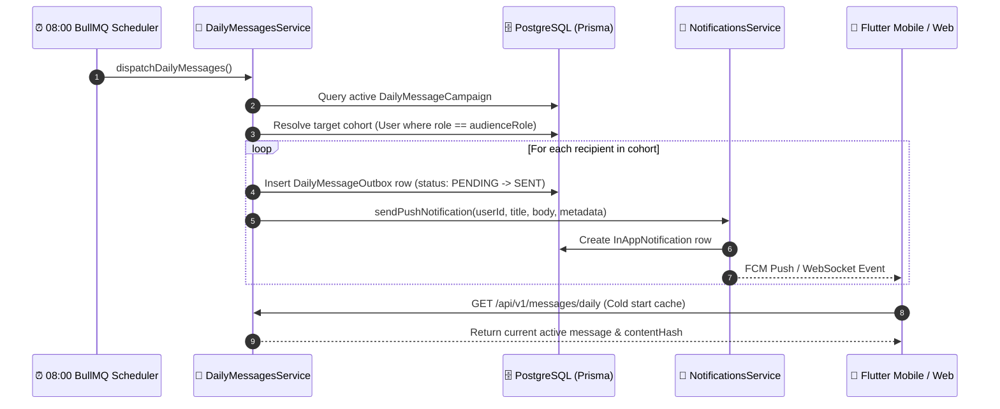

# 📢 Daily Messages & Marketing Campaigns Domain Specification

> **Feature Domain**: Daily Promotional, Operational & Marketing Loop (`services/api/src/modules/daily-messages`)  
> **Architecture Pattern**: Option A — Enterprise Server-Driven Cohort Marketing Loop with BullMQ 08:00 Scheduled Dispatch & Push/In-App Multi-Channel Delivery

---

## 1. Architectural Overview

The **Daily Messages** subsystem provides an automated, server-driven marketing loop for Daily Basket. It schedules morning promotional broadcasts at 08:00 server time, calculates deterministic content hashes (`SHA-256`) to prevent client-side churn, and delivers notifications across Firebase Cloud Messaging (FCM native push) and persistent in-app notifications.



---

## 2. Relational Data Models

Defined in [`services/api/prisma/schema.prisma`](../../services/api/prisma/schema.prisma):

### `DailyMessageCampaign` (`daily_message_campaigns`)
| Column | Type | Default | Description |
| :--- | :--- | :--- | :--- |
| `id` | `String` (UUID) | `@default(uuid())` | Primary campaign identifier |
| `title` | `String` | — | Marketing headline / notification title |
| `body` | `String` | — | Detailed campaign message |
| `content_hash` | `String?` | — | Deterministic `SHA-256` of `title:body` |
| `audience_role` | `String` | `"CUSTOMER"` | Targeted user role |
| `enabled` | `Boolean` | `true` | Active switch for scheduled selection |
| `segment_overrides` | `Json?` | — | Optional custom tags or geofence rules |
| `created_at` | `DateTime` | `now()` | Timestamp of creation |
| `updated_at` | `DateTime` | `updatedAt` | Auto-updating timestamp |

### `DailyMessageOutbox` (`daily_message_outbox`)
| Column | Type | Default | Description |
| :--- | :--- | :--- | :--- |
| `id` | `String` (UUID) | `@default(uuid())` | Unique dispatch record |
| `campaign_id` | `String` (FK) | — | References `DailyMessageCampaign.id` |
| `user_id` | `String` | — | Targeted customer user ID |
| `status` | `String` | `"PENDING"` | Delivery state (`PENDING`, `SENT`, `FAILED`) |
| `delivered_at` | `DateTime?` | — | Timestamp of delivery completion |
| `created_at` | `DateTime` | `now()` | Creation timestamp |

---

## 3. REST API Endpoints

Base Path: `/api/v1/messages/daily`

### 1. `GET /api/v1/messages/daily`
Fetches today's active Daily Message. Publicly addressable for mobile app cold starts and guest banner caching via `OptionalJwtAuthGuard`.

**Response (200 OK):**
```json
{
  "id": "e2c3b889-4b3f-42a1-a67b-1cb8ffbb5d70",
  "title": "Fresh Morning Harvest 🌿",
  "body": "Crisp organic greens, farm-fresh milk & seasonal berries delivered in 10 minutes!",
  "contentHash": "5a4df0c3452243d9b02a...",
  "audienceRole": "CUSTOMER",
  "enabled": true,
  "createdAt": "2026-11-01T08:00:00.000Z"
}
```

### 2. `POST /api/v1/messages/daily/dispatch`
*(Requires `ADMIN` or `SUPER_ADMIN` role)*  
Manually triggers immediate cohort dispatch for the active or specified campaign.

**Request:**
```json
{
  "campaignId": "e2c3b889-4b3f-42a1-a67b-1cb8ffbb5d70"
}
```

### 3. `POST /api/v1/messages/daily/campaigns`
*(Requires `ADMIN` or `SUPER_ADMIN` role)*  
Creates a new campaign. Computes and saves the SHA-256 content hash automatically.

### 4. `GET /api/v1/messages/daily/campaigns`
*(Requires `ADMIN` or `SUPER_ADMIN` role)*  
Lists all campaigns with outbox delivery counts.

---

## 4. Verification & Testing

Unit tests for `DailyMessagesService` are located at:
[`services/api/src/modules/daily-messages/daily-messages.service.spec.ts`](../../services/api/src/modules/daily-messages/daily-messages.service.spec.ts)

Execute with:
```bash
pnpm --filter api test daily-messages.service.spec.ts
```

